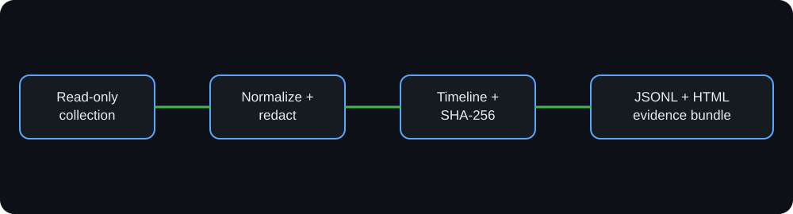
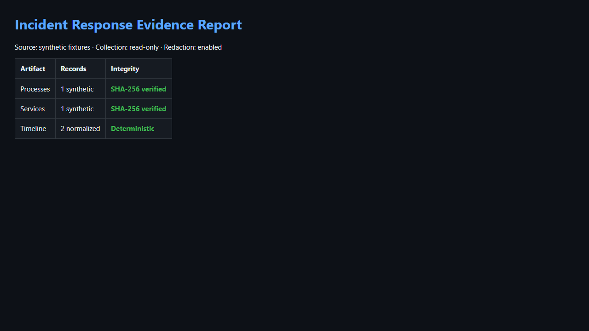

# Incident Response Evidence Collector

[Português](#português) | [English](#english)

## Português

Coletor defensivo e **somente leitura** para triagem inicial de um host Windows autorizado. Produz JSONL, hashes SHA-256, manifesto de cadeia de custódia, redaction opcional e uma timeline determinística.

Ele consulta apenas comandos nativos de leitura (`tasklist`, `netstat`, `sc query` e `wevtutil`). Não encerra processos, não remove arquivos, não altera serviços e não executa amostras.

```powershell
python -m pip install -e .
python -m ir_evidence.cli collect --output evidence
python -m ir_evidence.cli offline fixtures\synthetic_events.jsonl --output report --html
python -m unittest discover -s tests -v
```

Revise e redija o pacote antes de compartilhá-lo: evidências reais podem conter nomes de usuário, IPs e caminhos internos.

### Fluxo





Relatório navegável: [`examples/evidence-report.html`](examples/evidence-report.html).

## English

A defensive, read-only Windows triage collector producing normalized JSONL, SHA-256 manifests, optional redaction, and a deterministic timeline. It never runs malware or changes host state.

See [AUTHORIZATION.md](AUTHORIZATION.md), [THREAT_MODEL.md](THREAT_MODEL.md), and [SECURITY.md](SECURITY.md). License: MIT.
